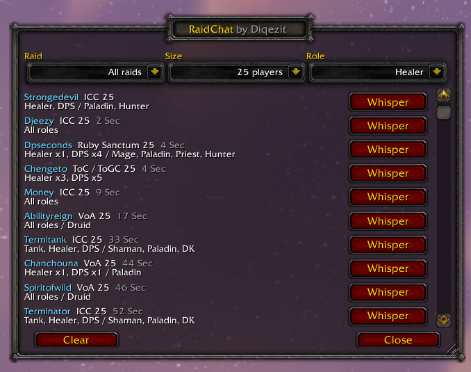
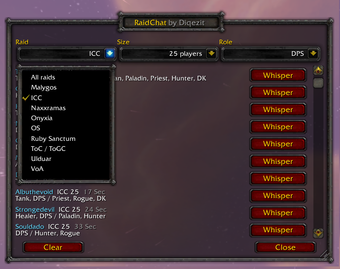
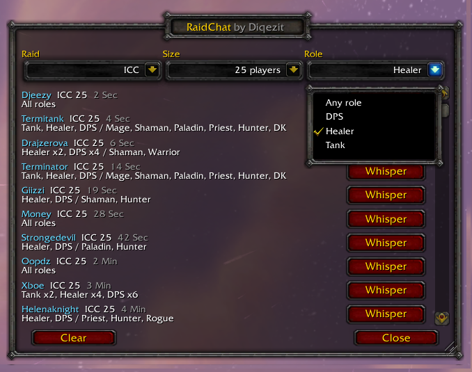

# RaidChat

Small raid recruitment addon for World of Warcraft 3.3.5a

I made this to collect raid ads in one window instead of reading the same spam in chat

## Screenshots

## Features

- collects ads from public channels, say and yell
- Raid, Size and Role filters
- repeated ads keep their position
- class colors and original messages on hover
- old ads removed after 15 minutes

## Installation

Copy the RaidChat folder to Interface/AddOns and enable it together with Ace3

Ace3 is required and is not included here

Restart the game after installing

## Commands

/raidchat or /rchat to open or close the window

/raidchat clear to clear the list

Whisper only opens the chat input and does not send a message
